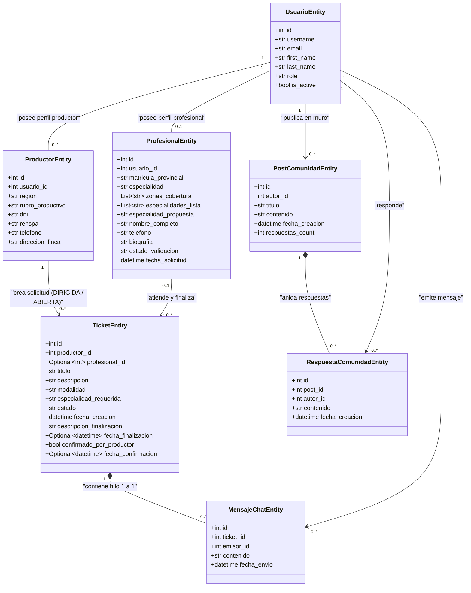
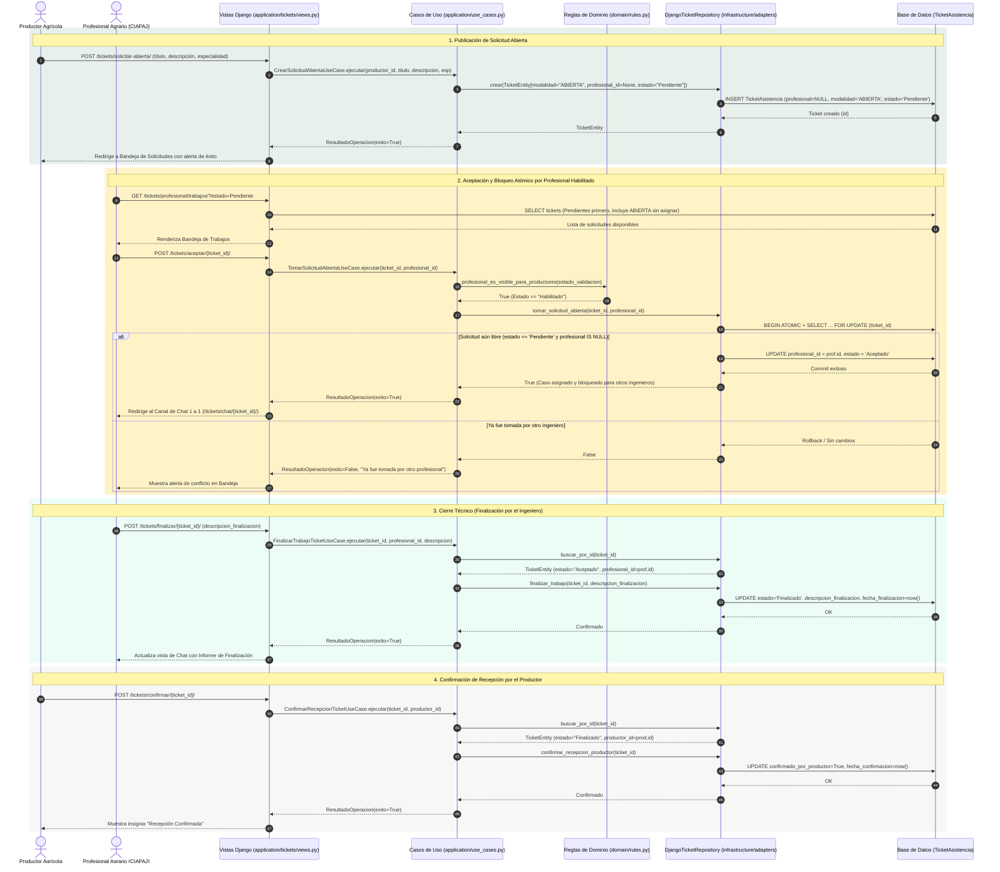

# Documentación UML — MVP AgroJujuy (Clean Architecture)

Documentación técnica generada a partir del código actual de las capas de **Dominio** (`domain/entities.py`, `domain/ports.py`, `domain/rules.py`), **Aplicación** (`application/use_cases.py`) e **Infraestructura** (`infrastructure/adapters/repositories.py`).

---

## 1. Diagrama de Casos de Uso

Representa las interacciones de los actores (**Productor**, **Profesional Agrario**, **Administrador CIAPAJ** y **Visitante Público**) con los módulos del sistema.

```mermaid
flowchart LR
    %% Actores
    Visitante(["👤 Visitante Público"])
    Productor(["🚜 Productor Agrícola"])
    Profesional(["🎓 Profesional Agrario"])
    Admin(["⚙️ Administrador CIAPAJ"])

    subgraph Sistema_AgroJujuy["Sistema AgroJujuy MVP"]
        direction TB

        subgraph Mod_Publico_Auth["Módulo de Registro, Seguridad y Acceso Público"]
            UC_Nosotros["Consultar Sección Nosotros"]
            UC_RegProd["Registrarse con Validación DNI y RENSPA"]
            UC_RegProf["Registrarse con Matrícula CIAPAJ y Múltiples Especialidades"]
            UC_AjaxUser["Validar Disponibilidad de Usuario en Tiempo Real (AJAX)"]
            UC_Espera["Visualizar Pantalla de Espera (24 a 48 hs)"]
            UC_PerfilProd["Editar Datos Operativos de Finca (Perfil Protegido)"]
            UC_PerfilProf["Editar Zonas y Contacto en Mi perfil CIAPAJ (Perfil Protegido)"]
        end

        subgraph Mod_Buscador["Módulo Buscador Inteligente y Vitrina"]
            UC_Buscar["Filtrar Profesionales Automáticamente por Región y Especialidad"]
            UC_PaginarProf["Navegar Perfiles Habilitados Paginados"]
            UC_Vitrina["Consultar Vitrina Digital Pública del Profesional"]
        end

        subgraph Mod_Tickets["Módulo de Solicitudes de Asistencia y Chat 1 a 1"]
            UC_SolDirigida["Enviar Solicitud Dirigida a Ingeniero Específico"]
            UC_SolAbierta["Publicar Solicitud Abierta a la Red CIAPAJ"]
            UC_TomarAbierta["Aceptar Solicitud y Bloquear Caso (select_for_update)"]
            UC_BandejaProf["Filtrar Bandeja de Trabajos (Pendientes Primero)"]
            UC_Chat["Dialogar en Canal Directo Privado (1 a 1)"]
            UC_Finalizar["Marcar Trabajo como Finalizado con Informe y Fecha"]
            UC_Confirmar["Confirmar Recepción Conforme del Trabajo"]
        end

        subgraph Mod_Comunidad["Módulo Foro / Muro Comunitario"]
            UC_VerForo["Explorar Resúmenes, Carrusel y Buscar por Palabras Clave"]
            UC_CrearPost["Publicar Problema, Idea o Consulta en el Muro"]
            UC_ResponderPost["Agregar Respuesta Técnica Anidada"]
        end

        subgraph Mod_Admin["Módulo de Administración Institucional (Django Admin)"]
            UC_AuditarMat["Cruzar y Validar Matrículas Provinciales CIAPAJ"]
            UC_Habilitar["Habilitar o Suspender Profesionales"]
            UC_SimularRol["Cambiar Rol Temporal en Header Global (Auditoría Visual)"]
        end
    end

    %% Relaciones Visitante
    Visitante --> UC_Nosotros
    Visitante --> UC_RegProd
    Visitante --> UC_RegProf
    Visitante --> UC_Buscar
    Visitante --> UC_Vitrina
    Visitante --> UC_VerForo

    %% Inclusión de validación AJAX en registros
    UC_RegProd -.->|"include"| UC_AjaxUser
    UC_RegProf -.->|"include"| UC_AjaxUser
    UC_RegProf -.->|"redirige si Pendiente"| UC_Espera

    %% Relaciones Productor
    Productor --> UC_Buscar
    Productor --> UC_PaginarProf
    Productor --> UC_Vitrina
    Productor --> UC_SolDirigida
    Productor --> UC_SolAbierta
    Productor --> UC_Chat
    Productor --> UC_Confirmar
    Productor --> UC_PerfilProd
    Productor --> UC_VerForo
    Productor --> UC_CrearPost
    Productor --> UC_ResponderPost

    %% Relaciones Profesional
    Profesional --> UC_BandejaProf
    Profesional --> UC_TomarAbierta
    Profesional --> UC_Chat
    Profesional --> UC_Finalizar
    Profesional --> UC_PerfilProf
    Profesional --> UC_VerForo
    Profesional --> UC_CrearPost
    Profesional --> UC_ResponderPost

    %% Relaciones Administrador
    Admin --> UC_AuditarMat
    Admin --> UC_Habilitar
    Admin --> UC_SimularRol
```

---

## 2. Diagrama de Clases (Capa de Dominio)

Enfocado estrictamente en las entidades de negocio definidas en `domain/entities.py` y las reglas/puertos de `domain/rules.py` y `domain/ports.py`.

---

## 3. Diagrama de Secuencia (Ciclo de Solicitud Abierta hasta Cierre y Confirmación)

Detalla el flujo completo a través de las capas de la arquitectura hexagonal desde que el **Productor** publica una **Solicitud Abierta** hasta que un **Profesional** habilitado la acepta/bloquea, la marca como **Finalizada** y el **Productor** confirma su recepción.

